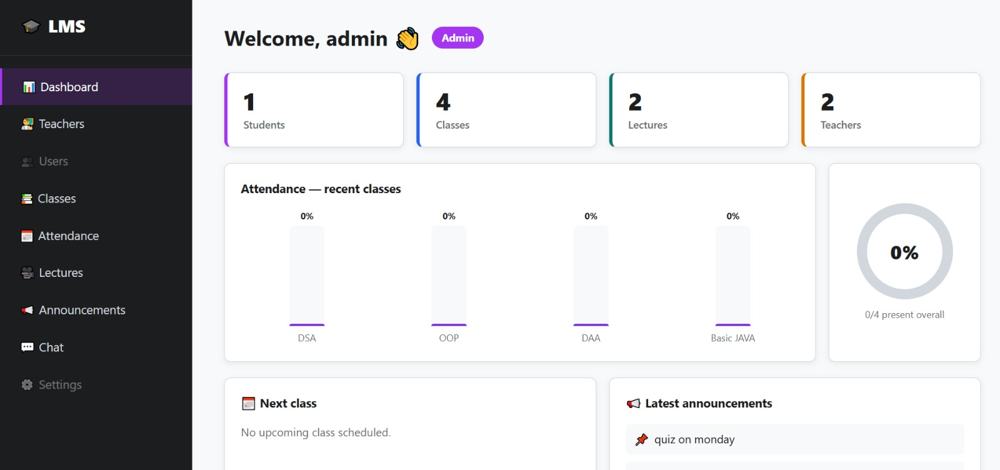
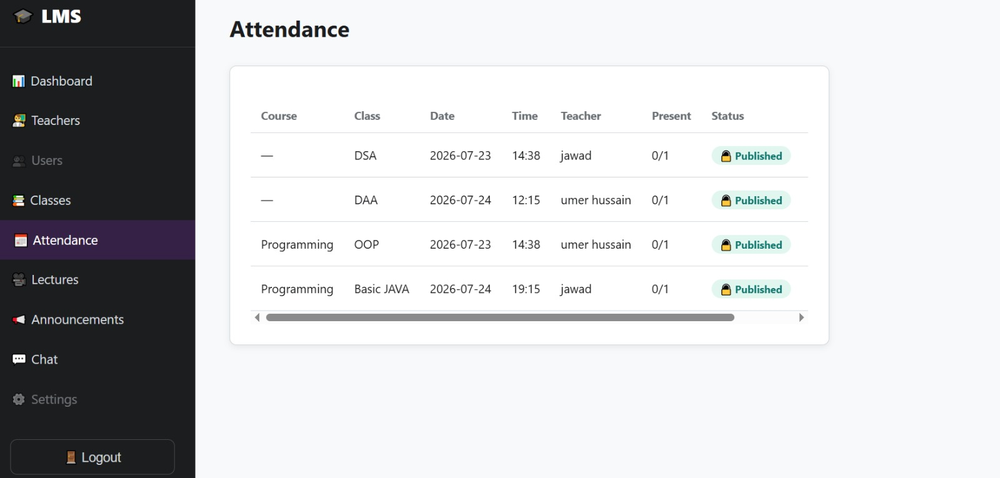
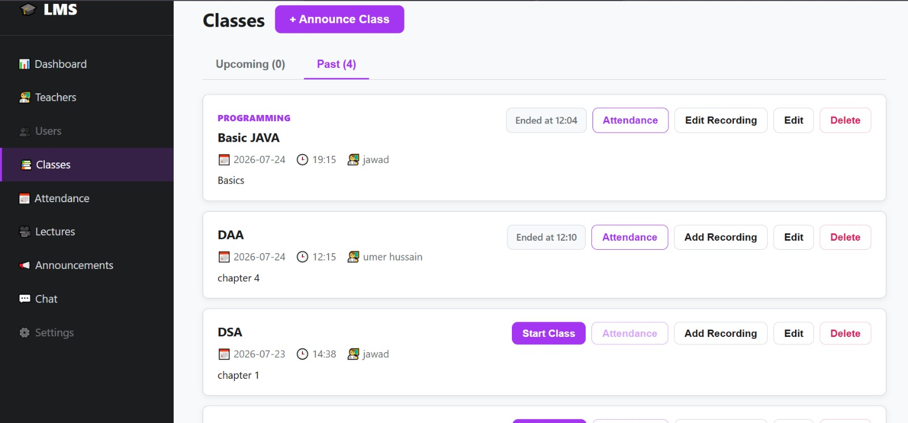
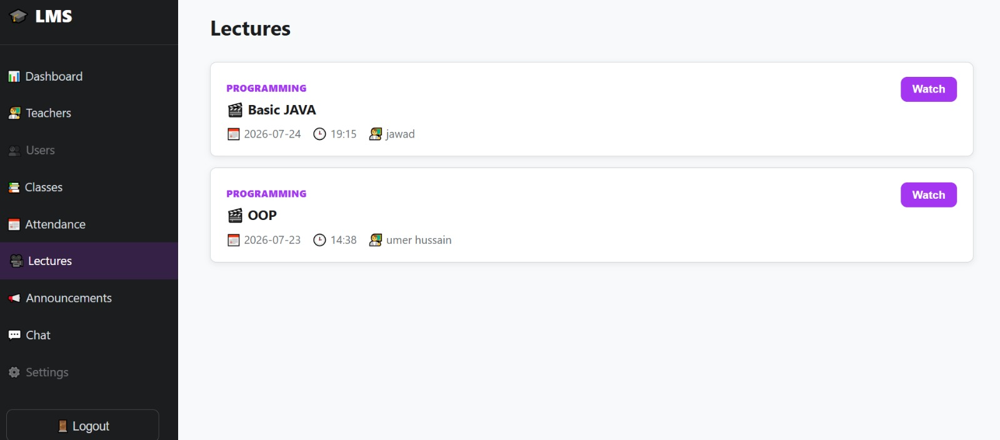

# UBIT Learning Management System (LMS)

A full-stack Learning Management System developed collaboratively as a university project for the Department of Computer Science (UBIT), University of Karachi.

The platform helps teachers and students manage online classes, attendance, recorded lectures, and real-time communication through a centralized web application.

## Features

- **Role-Based Authentication:** Separate access for Admin, Student, and Visitor accounts.
- **Class Management:** Create and schedule classes with Google Meet integration.
- **Teacher Management:** Manage teacher accounts, including removal and reactivation.
- **Attendance Tracking:** Track student join/leave records, manually edit attendance, and publish attendance records.
- **Recorded Lectures:** Access YouTube-based recorded lectures with clickable chapter timestamps.
- **Real-Time Group Chat:** WebSocket-based communication with admin moderation.

## Technology Stack

| Layer | Technologies |
|---|---|
| Frontend | React, Vite, CSS |
| Backend | Python, Django, Django REST Framework |
| Real-Time Communication | Django Channels, WebSockets |
| Database | SQLite, PostgreSQL |
| Authentication | JWT |
| Online Classes | Google Meet Integration |

## Project Structure

```text
UBIT-LMS/
│
├── backend/       # Django backend, REST APIs and WebSockets
├── frontend/      # React frontend application
├── README.md
└── .gitignore
```

## Run Locally

### Prerequisites

- Python
- Node.js and npm
- Git

### 1. Clone the Repository

```bash
git clone https://github.com/jawadkaxmi/UBIT-LMS.git
cd UBIT-LMS
```

### 2. Set Up the Backend

```bash
cd backend
python -m venv venv
```

Activate the virtual environment:

**Windows (Command Prompt):**

```bash
venv\Scripts\activate
```

**Windows (PowerShell):**

```powershell
.\venv\Scripts\Activate.ps1
```

**macOS / Linux:**

```bash
source venv/bin/activate
```

Install dependencies and initialize the database:

```bash
pip install -r requirements.txt
python manage.py migrate
python manage.py createsuperuser
python manage.py runserver
```

The backend will be available at:

`http://127.0.0.1:8000`

### 3. Set Up the Frontend

Open another terminal in the project directory:

```bash
cd frontend
npm install
npm run dev
```

The frontend will be available at:

`http://localhost:5173`

## Developers

Collaboratively developed by:

- [jawadkaxmi](https://github.com/jawadkaxmi)
- [umer29github](https://github.com/umer29github)

## Academic Project

Department of Computer Science (UBIT)  
University of Karachi, Pakistan.

---

**GitHub Repository:** [UBIT Learning Management System](https://github.com/jawadkaxmi/UBIT-LMS)


## Screenshots

<h3>Dashboard</h3>


<h3>Attendance</h3>


<h3>Classes</h3>


<h3>Lectures</h3>

